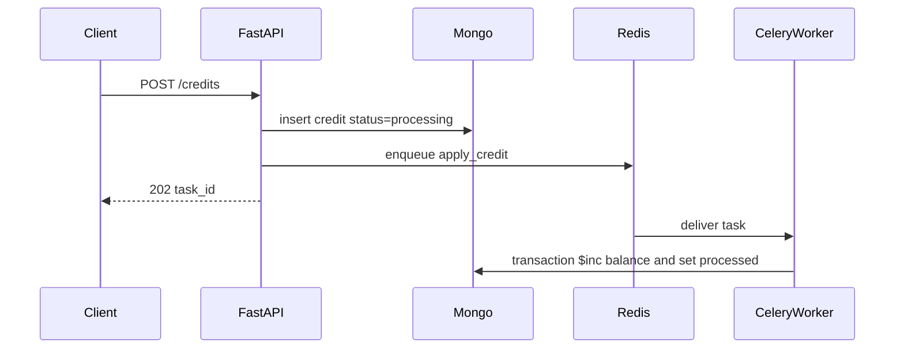

# Technical Design Document: Async Credit Processing Service

- **Author:** Liem Do
- **Status:** Implemented
- **Target audience:** Engineering reviewers / tech leads

## 1. Overview and objectives

The service accepts a credit over HTTP and updates the user's balance on a worker. The API returns once the credit is stored and queued. A redelivered task must not add the money twice.

- The API returns **202 Accepted** with a `task_id` after the credit is stored as `processing`.
- A Celery worker, with Redis as the broker, executes the credit. Delivery is at-least-once. The balance update is exactly once.
- The transition `processing` → `processed` is committed in one MongoDB transaction with the balance increment.

Clients read MongoDB for the outcome. `GET /credits/{task_id}` returns the credit. `GET /users/{user_id}` returns the committed balance.

## 2. Architecture and system flow

Four processes share the work. The API and the worker are one Python application, started with different commands from one image.



**API.** FastAPI on Python 3.11+ and Pydantic. Routes call `CreditApplication` and do not update the balance.

**Queue.** Redis and Celery, with no result backend. The worker acknowledges late, returns a task if the process dies, and prefetches one message.

**Datastore.** MongoDB holds `users` and `credits`. Compose runs replica set `rs0` so the balance update can be a multi-document transaction.

## 3. Key design decisions and rationale

**Accept and apply are separate.** The request validates, inserts, and enqueues. The balance update does not hold the HTTP call. If Redis rejects the publish, the API marks that credit `failed` and returns **503**.

**Status lives on the credit. The balance lives on the user.** Two credits for one user can be in flight together. One user document cannot hold both statuses, so the second write would replace the first and a retry could apply the wrong amount. Each credit is its own document (`processing`, `processed`, or `failed`). The user document stores `user_id` and `balance` only, and is created when the first credit is applied. `failed` means the credit will not be applied.

**Redelivery does not double-credit.** Celery can deliver a task more than once. Inside the transaction, the worker updates the credit only when its status is still `processing`, then `$inc`s the balance. The worker that loses that update aborts and does not increment. A later delivery of a `processed` or `failed` credit is a no-op.

**The idempotency key covers client retries, not worker retries.** An optional `Idempotency-Key` header with the same body returns the original task and does not publish again, including when that task `failed`. The same key with a different body returns **409**. A second POST without the header is a second credit.

## 4. Implementation approach

`POST /credits` accepts this body and returns **202**. `amount` is a decimal string, greater than zero, at most `1000000.00`, with at most two decimal places. `user_id` is 1–128 characters from letters, digits, `_`, and `-`. Invalid input returns **422**.

Request:

```json
{
  "user_id": "u_123",
  "amount": "150.00"
}
```

Response:

```json
{
  "task_id": "<uuid>",
  "status": "processing"
}
```

The user document holds the balance. The credit document holds the status.

`users`:

```json
{
  "user_id": "u_123",
  "balance": "150.00"
}
```

`credits`:

```json
{
  "task_id": "<uuid>",
  "user_id": "u_123",
  "amount": "150.00",
  "status": "processed"
}
```

Indexes are a unique `user_id` on users, a unique sparse `idempotency_key` on credits, and `user_id` on credits.

`accept` inserts the processing credit and publishes. A duplicate key returns the original row. `apply` runs the transaction only while the credit is `processing`. The task calls `apply`. Database and network errors retry up to five times with exponential backoff. Any other error, or the last retry, sets `failed` only while the credit is still `processing`. A crash after the insert and before publish can leave a credit `processing` with nothing queued. Nothing sweeps that gap.

## 5. Testing strategy

**Unit tests** (`pytest`) build `CreditApplication` on in-memory repositories, a publisher, and a unit of work. They cover one apply, a no-op second apply, idempotent replay and **409**, invalid input, a broker failure, a lost claim, and a database error during apply. A non-retryable worker error is marked `failed` immediately; a first network error stays `processing`.

**Integration tests** use Compose MongoDB and Redis and write to `credits_test`. They POST through the real repositories, then apply in process, except one test that publishes to Redis.

## 6. Trade-offs and future work

Redis is the broker because this workload is one task type with retries. RabbitMQ or Kafka would add weight without a routing or retention need here.

Clients poll `GET /credits/{task_id}`. A webhook or WebSocket could replace that poll later.

A ledger of immutable entries would make an audit easier. The conditional credit update would still be required, so a redelivery does not append the same entry twice.
