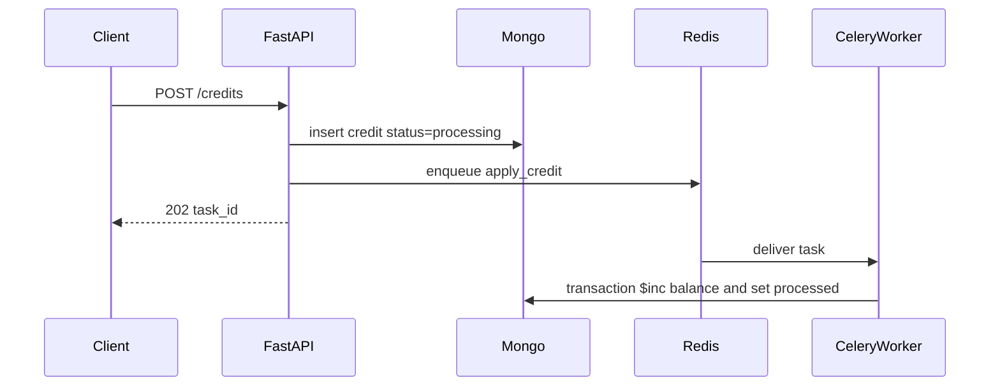

# Async credit service

A client submits a credit and gets a task id immediately. The balance changes later, on a worker, and a repeated delivery of that same task must not add the money twice. The service is four processes: a FastAPI API, a Celery worker, Redis, and MongoDB. The API and the worker are the same Python application, started with different commands from one image.

## Architecture

The API accepts the credit, records it, and enqueues work. Redis carries the task. The worker applies it. MongoDB holds both the credit and the balance, and it is the only place a client looks to see whether the credit finished. Celery has no result backend.

`POST /credits` validates `user_id` and `amount`, inserts a credit with status `processing`, and publishes `credits.apply_credit` with that task id. The response is 202. The client then calls `GET /credits/{task_id}` until the status is `processed` or `failed`, and `GET /users/{user_id}` to read the committed balance.

The worker loads the credit and, in one MongoDB transaction, increments the user's balance and sets the credit to `processed`. The user document is created on that first successful credit. A credit that is already `processed` or `failed` is left alone.

## Components

**API.** FastAPI routes in `app/api` validate input and map failures to HTTP. `POST /credits` returns 202, 409, 422, or 503. `GET /credits/{task_id}` and `GET /users/{user_id}` return the stored credit or balance, or 404. `GET /health` reports MongoDB and Redis and returns 503 when either is down. Domain errors become those status codes in one place (`app/api/errors.py`), so a route does not build error bodies itself.

**Credit service.** `CreditApplication` in `app/services/credits.py` is the use case both the API and the worker call. `accept` stores the credit and publishes it. `apply` performs the balance update. The HTTP layer and the Celery task stay thin so the rules live in one class.

**Persistence.** `MongoCreditRepository` and `MongoUserRepository` read and write the `credits` and `users` collections. `MongoUnitOfWork` opens the transaction that `apply` uses. Indexes are a unique `user_id` on users, a unique sparse `idempotency_key` on credits, and `user_id` on credits.

**Broker and worker.** `CeleryTaskPublisher` calls `apply_credit.delay`. The task in `app/tasks.py` calls `CreditApplication.apply` and decides whether a failure should be retried or recorded. Redis is the broker only.

**MongoDB.** Two collections, not one. `users` stores `user_id` and `balance`. `credits` stores `task_id`, `user_id`, `amount`, `status` (`processing`, `processed`, or `failed`), an optional `idempotency_key`, timestamps, and an optional `error`. Compose runs MongoDB as a single-node replica set, `rs0`, because the balance update is a multi-document transaction.

## Design decisions

Status lives on the credit, and the balance lives on the user. Two credits for the same user can be `processing` at the same time. Each has its own document, so one credit's status cannot replace the other's, and a retry of one task cannot apply the other credit.

The increment and the status change commit together. The update from `processing` to `processed` matches only a credit that is still `processing`. If two workers take the same task, one update matches and that worker increments the balance. The other finds the credit already moved, aborts the transaction, and does not increment. Celery is at-least-once, so this conditional update is the exactly-once guard. The worker acknowledges late, returns the task to the queue if the process dies, and prefetches one message.

`failed` is an extra status so a credit that will never be applied is visible. Database and network errors retry up to five times with backoff. Any other error, or a retryable error after that budget, sets `failed` and acknowledges the message. The balance is unchanged.

`Idempotency-Key` is optional. The same key and body return the original task, including a failed one, and do not publish a second time. The same key with a different body returns 409. A second POST without the header is a second credit.

If Redis rejects the publish, the API sets that credit to `failed` and returns 503, so the client can tell the credit was not queued. A crash after the insert and before the publish can still leave a credit in `processing` with nothing on the queue. There is no sweeper for that gap. The API and the worker use a synchronous MongoDB driver because the worker is synchronous. An async driver would fight that process.

## Implementation approach

The code follows the request inward. Routes depend on a `CreditService`. `app/api/deps.py` builds `CreditApplication` with the MongoDB repositories, the Celery publisher, and a unit-of-work factory. Tests replace that publisher, or the whole service, without changing the routes.

`accept` checks for an existing idempotency key, inserts the processing credit, and publishes. A duplicate key from a concurrent insert loads the original credit and returns it. `apply` reads the credit, returns immediately when it is missing or no longer `processing`, and otherwise runs the transaction. Repositories do not know about HTTP or Celery. The task does not contain the balance rules. It calls `apply`, and on failure it either lets Celery retry or calls `mark_failed`.

Configuration is `MONGODB_URI`, `MONGODB_DATABASE`, `REDIS_URL`, and `PORT`. Compose starts `api`, `worker`, `mongo`, and `redis`. The API command is uvicorn. The worker command is `celery -A app.tasks worker`.

## Testing

Tests are split so the credit rules can fail without a database, and the MongoDB behavior can still be checked against a real server.

Unit tests build `CreditApplication` with in-memory credit and user repositories, a publisher that records task ids or raises, and a unit of work that records commit and abort. They cover the success path: accept publishes one processing credit, apply adds the amount once, a second apply does not add it again, and the same idempotency key returns the original task. They also cover invalid amounts and user ids, an idempotency conflict, a broker outage that marks the credit failed, a lost claim that aborts without incrementing, a database error during apply, and the worker's choice to fail a non-retryable error immediately while leaving a retryable error in `processing`. A small FastAPI app with the real routes and exception handlers checks 202, 422, 404, and 503 without opening MongoDB.

Integration tests use the Compose MongoDB and Redis and write to the `credits_test` database. They drive `POST /credits` through the real repositories. Most of them substitute a recording publisher and then call `apply` in process, so the suite does not wait on a worker. One test publishes to the real broker. Together they check validation, a balance that increases once, idempotent replay and conflict, a publish failure that returns 503 and stores `failed`, unknown ids, and health.
